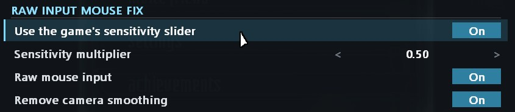

# Raw Input Mouse Fix (DS3 Mod Loader adaptation)

> **This is an add-on for the [DS3 Mod Loader](https://github.com/RHFlyer/Dead-Space-3-Mod-Loader/releases/latest), and needs version 1.0.0 or
> later.** It does nothing without the loader. Install the loader first, then this.

> **Based on the [Raw Input Mouse Fix](https://github.com/slopkhayzo/DeadSpace3-RawInputMouseFix) by
> slopkhayzo.** All credit for the fix, and for finding where Dead Space 3 filters and smooths the mouse, goes to
> them. This repo is their fix (version 1.1.2) moved onto the DS3 Mod Loader's mod SDK, as their MIT licence allows
> ([`THIRD-PARTY-NOTICES.txt`](THIRD-PARTY-NOTICES.txt)). If you don't use the DS3 Mod
> Loader, use [slopkhayzo's original](https://github.com/slopkhayzo/DeadSpace3-RawInputMouseFix) instead.

**1:1 mouse aim in Dead Space 3, without the game's mouse acceleration and camera smoothing.**

## What it does

- **Raw mouse input:** reads the mouse through Windows raw input (the movement the mouse really sent) and uses it
  for the aim, instead of the game's filtered turn rate. No acceleration, no speed limit.
- **No camera smoothing:** the camera follows the mouse at once, instead of easing after it.
- **The game's own slider still works:** with **Use the game's sensitivity slider** on, the Mouse Sensitivity
  slider in the game's settings (settings > controls) sets the speed, as you're used to.

What's different from slopkhayzo's standalone fix (the full list is in [`CHANGELOG.txt`](CHANGELOG.txt)):

- It loads through the DS3 Mod Loader, so you switch it on and off in the loader's Mods panel, and its settings are
  there too. They apply at once.
- The game's slider sets the speed by default, and the multiplier starts at 0.50 (the speed at slider 50). The
  standalone fix starts at 1.00 and doesn't use the slider.
- With the loader's hot reload, a new build of the mod can be swapped in while the game runs (for mod makers).
- It has no thread of its own and doesn't write its hooks into the game itself: the loader makes and checks both
  hooks.

## Settings

In the Mods panel (pause, "mods", Raw Input Mouse Fix). A change applies at once, without a restart.



| Setting | Default | What it does |
|---|---|---|
| Use the game's sensitivity slider | On | On: the game's Mouse Sensitivity slider sets the speed. At slider 50 the fix runs at the multiplier below; 25 is half, 100 is double. Off: only the multiplier sets it. |
| Sensitivity multiplier | 0.50 | Overall mouse speed of the fix, from 0.10 to 5.00. |
| Raw mouse input | On | 1:1 mouse movement, without the game's acceleration. |
| Remove camera smoothing | On | The camera follows the mouse at once instead of easing after it. |

The settings are kept in `plugins\RawInputMouseFix\ds3_raw_mouse.ini`, the same file as the standalone fix, with
one more key, `UseGameSlider`. The mod writes it there, with every key and its default, on its first start. Some keys are only in the file:

| Key | Default | What it does |
|---|---|---|
| `Hotkeys` | true | Turns the F6-F10 keys below on or off. |
| `Diagnostics` | true | Writes counters to `DS3RawMouse.log` every five seconds, unless nothing happened. |
| `ThirdPersonSensitivityX` / `Y` | 0.000700 / 0.001850 | How far the camera turns per mouse count, when you don't aim. |
| `AimSensitivityX` / `Y` | 0.001100 / 0.001100 | The same while you aim (right mouse button held). |

**Keys in game:** F6 reads `ds3_raw_mouse.ini` again. F7 switches camera smoothing removal on and off, F8 raw
mouse input. F9 and F10 lower and raise the multiplier by 0.05 (until F6, a change in the Mods panel or a restart),
only while **Use the game's sensitivity slider** is off. The keys do nothing while the Mods panel is open or another program is in front.

## Install

1. Install the [DS3 Mod Loader](https://github.com/RHFlyer/Dead-Space-3-Mod-Loader/releases/latest) 1.0.0 or later, if you haven't.
2. **Back up your saves**: copy `Documents\EA Games\Dead Space 3` somewhere safe.
3. Close the game. Download `RawInputMouseFix-v1.0.0.zip` from [Releases](https://github.com/RHFlyer/Dead-Space-3-Mouse-Fix-Adaptation/releases/latest) and unzip
   it into the game folder, next to `deadspace3.exe` (Steam: right-click Dead Space 3 > Manage > Browse local
   files). You get `plugins\RawInputMouseFix\`.
4. Start the game, pause, choose **mods**, switch **Raw Input Mouse Fix** on, and restart the game.

The Raw Input Mouse Fix is also in the DS3 Mod Loader's add-ons download. If you installed it from there, you already
have it, and unzipping a newer version from this page over it is an update: your switch and settings stay.

**Coming from slopkhayzo's standalone fix?** Remove its `DS3RawMouse.asi`, wherever you put it (next to
`deadspace3.exe`, or in `scripts\` or `plugins\`): only one of the two can run, and whichever starts second stays
off. Copy your old `ds3_raw_mouse.ini` into
`plugins\RawInputMouseFix\` to keep your settings. That file has no `UseGameSlider` line, so the game's slider then
sets the speed; switch **Use the game's sensitivity slider** off to aim exactly as before.

**Update**: close the game, unzip the new version into the game folder over the old one, and let Windows replace
the files. Your switch and settings are kept. `CHANGELOG.txt` says what changed.

**Remove**: close the game and delete `plugins\RawInputMouseFix\` (its settings go with it). To stop it for a while
instead, switch it off in the Mods panel and restart the game.

## Good to know

- Made for the **Steam** version of Dead Space 3. Tested at 1920x1080 with keyboard and mouse.
- **Co-op hasn't been tested.** If you try it, please report what happens.
- If your copy of the game differs from the one this mod was made for, the mod stays off (or uses only the part that
  fits), the game's own mouse handling stays, and `ds3_mods.log` says why.
- No game files are changed on disk, the mod reads no account data and makes no network connections.
- Found a bug? [Open an issue](https://github.com/RHFlyer/Dead-Space-3-Mouse-Fix-Adaptation/issues) and attach `ds3_mods.log` from the game folder and
  `plugins\RawInputMouseFix\DS3RawMouse.log`. They don't hold account details or your Windows user name, but read a
  log before you post it.

## Building from source

Needs Windows, Build Tools for Visual Studio 2022 ("Desktop development with C++") and CMake, as for the
[DS3 Mod Loader](https://github.com/RHFlyer/Dead-Space-3-Mod-Loader).

```
cmake -S . -B build -A Win32
cmake --build build --config Release
```

The mod is then ready in `build\plugins\RawInputMouseFix\`. `scripts\package-mod.ps1` makes the release zip from it.

`ds3mod.h` is a copy of the DS3 Mod Loader's SDK header from loader 1.0.0, the oldest loader this mod works
with. `ds3mod.h.pin` says where it came from, and the build check refuses a changed copy. To learn how a mod like
this is made, start with the loader's guide, [`sdk/README.md`](https://github.com/RHFlyer/Dead-Space-3-Mod-Loader/blob/main/sdk/README.md).
`RawInputMouseFix/raw_mouse.cpp` explains its two hooks and the raw mouse input at the top of the file.

## How this was made

The fix itself is slopkhayzo's work. Moving it onto the SDK was done, like the loader, with a lot of help from AI
(Claude and Codex), and I tested every release in the game myself. More in the loader's README,
["How this was made"](https://github.com/RHFlyer/Dead-Space-3-Mod-Loader#how-this-was-made).

## Credits and licence

- **The Raw Input Mouse Fix:** by slopkhayzo, MIT licence. Their notice is in
  [`THIRD-PARTY-NOTICES.txt`](THIRD-PARTY-NOTICES.txt) and
  [`RawInputMouseFix/LICENSE-RawInputMouseFix.txt`](RawInputMouseFix/LICENSE-RawInputMouseFix.txt), and it ships in
  the download.
- **The SDK port** and the rest of this repo: by RHFlyer, MIT licence ([`LICENSE.txt`](LICENSE.txt)).

Like the DS3 Mod Loader, this mod never touches paid DLC, entitlements, ownership or the game's copy protection.

Dead Space 3 is a trademark of Electronic Arts Inc. This project is not made, endorsed or supported by Electronic
Arts and contains no game files.
